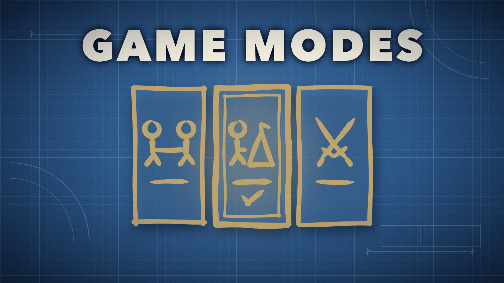

# Game Modes



Game modes, game settings and a saved record of how a game was made, for mods that change how Timberborn plays.

On its own it changes nothing: with no mod adding a mode, New Game is the game's own. [BeaverBuddies Co-Op/PvP Edition](https://github.com/FezVrasta/BeaverBuddies-CoOp-PvP-Edition) and [Timber Empires](https://steamcommunity.com/sharedfiles/filedetails/?id=3814012422) add theirs.

## For mod authors

[Samples/HelloMode](Samples/HelloMode) is a small mod that adds a game mode with a game setting, and reads them as the game loads.

Depend on it in your manifest (`{ "Id": "gamemodes" }`), reference `GameModes.dll` and register your modes when the game starts:

```csharp
GameModes.Modes.Add("mymod.race", "MyMod.GameMode.Race", alone: true, withOthers: false);
GameModes.Modes.Describe("mymod.race", "MyMod.GameMode.Race.Description");
GameModes.Modes.DescribeAlone("mymod.race", "MyMod.GameMode.Race.Description.Alone");
```

`Modes.SetDefault(id, alone: false)` says which mode is picked until the player picks one, since otherwise it's the first added, which depends on which mod loads first.

A mode shows on the page when it's offered for what the page is making (a game alone, or with others, see `PageAlone`), and the column shows once there are two to pick from. The new game's mode is read while it loads:

| | |
|---|---|
| `Modes.Game` | the mode the new game loading was started in, null for a saved game |
| `Modes.GameAlone` | whether it's played alone |
| `Modes.Record()` | the mode as it's saved with the game (`bb.gamemode`, `bb.alone`) |
| `Modes.ModeOf(record)` | a saved game's mode |
| `Modes.PickedMode(alone)` | what the player has picked on the page |
| `Modes.Picked` | event, a pick was made |

A mod that starts games with others (multiplayer) sets `Modes.PageAlone` to say when the page is for one, and starts it with `Modes.StartWith(mode, alone: false)`. `GameModeColumn.Column` and `GameModeColumn.Button` build more columns that look like the difficulties'.

`Classic` (`gamemodes.classic`) is the game as it comes, offered for games alone.

## Backgrounds

A mode can have a picture behind the New Game screens while it's picked, and behind the loading screen of a game in it:

```csharp
Modes.SetBackground("mymod.race", menu: () => pathToJpg, loading: () => pathToJpg);
```

Each is a function returning an image file's path when the screen shows (null for none), so the picture can change with the date or a setting. `Backgrounds.Show(element, path)` puts a picture on a screen's background element yourself, for screens a mod draws over (a hosting box, say). See [Samples/HelloMode](Samples/HelloMode).

## Game settings

Rules a mod adds to the New Game screens' Customize list (a toggle, a choice, a slider, a list), picked when the game is created and saved with it. Define them once, typed, under your own heading:

```csharp
static readonly SettingGroup Rules = GameSettings.Group("MyMod.Settings");   // the heading's loc key

public static readonly ToggleSetting Pressure = Rules.Toggle("mymod.pressure", "MyMod.Settings.Pressure");
public static readonly SliderSetting Raids = Rules.Slider("mymod.raids", "MyMod.Settings.Raids", 0, 20, 1, 7)
    .When(kind => kind.Is("mymod.race"));
public static readonly ChoiceSetting Victory = Rules.Choice("mymod.victory", "MyMod.Settings.Victory", "camps", "camps", "ruins");
public static readonly ListSetting Bots = Rules.List("mymod.bots", "MyMod.Settings.Bots", "MyMod.Settings.Bot", 3, "normal", "easy", "normal", "hard");
```

Text keys follow from the one given: the setting's name, `+ ".Tooltip"` for what hovering it says, `+ ".Value"` for how a slider's value reads (`"{0} %"`, with `.<value>` for a value that has a word of its own and `.Min` for the lowest), `+ "." + value` for a choice's values. Change any with `Tip`, `ValueText`, `ValueKeys`, `Small` (a line of small print under the name), and give each difficulty its own value with `Presets(easy, normal, hard)`.

`When` says which games a setting is for, by the mode, alone or with others (`GameKind`); a group's `When` is the default for what's defined under it. Read a setting as the game loads:

| | |
|---|---|
| `Pressure.Value` | the pick for the new game loading (its default for a saved game, which keeps its own copy) |
| `Pressure.TryGetNewGameValue(out v)` | the same, and whether there is a pick |
| `Pressure.Of(record)` | the value in a game's record, for a save read without loading it |
| `Pressure.Current` | the loaded game's |
| `Pressure.Picked` | what the player has picked on the page now |

A game's record (`GameRecord`) is its mode and settings, saved with it and in its metadata, and shown in the Load Game box. It's there from the first moment a game loads (`Modes.CurrentRecord`, `Modes.Current`, `Setting.Current`), whether it's new or saved. `GameRecord.ReadFromSave(repository, save)` reads it without loading the save, and `Modes.GameLoading` tells you how each game was made as it starts loading. A mod that kept a setting's value with the game itself before records existed hands it over as that older save loads, with `setting.Complete(value)`. `GameSettings.AddRow` puts a row of your own, made by hand, in the list under a heading.

## Building

Copy `GameModes/env.props.*-template` to `GameModes/env.props` and point it at Timberborn and Harmony, then `dotnet build GameModes/GameModes.csproj`. It installs into `Documents/Timberborn/Mods/GameModes`.

## License

GPL-3.0, see [LICENSE](LICENSE).
